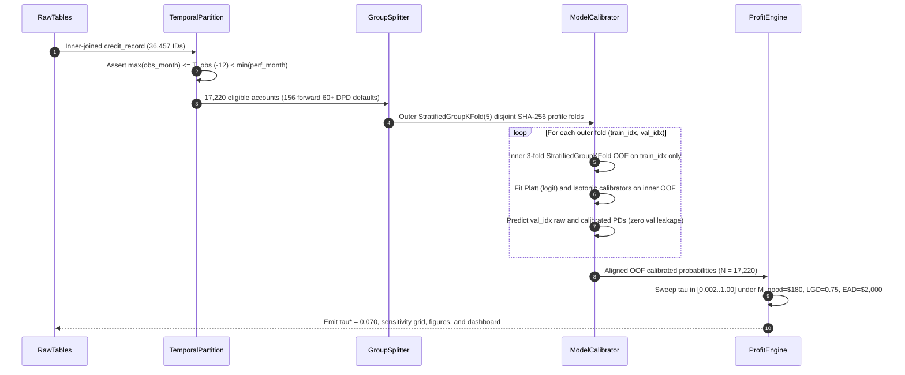
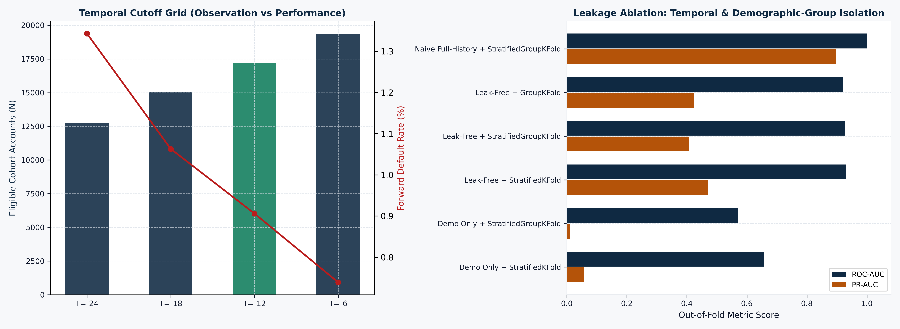
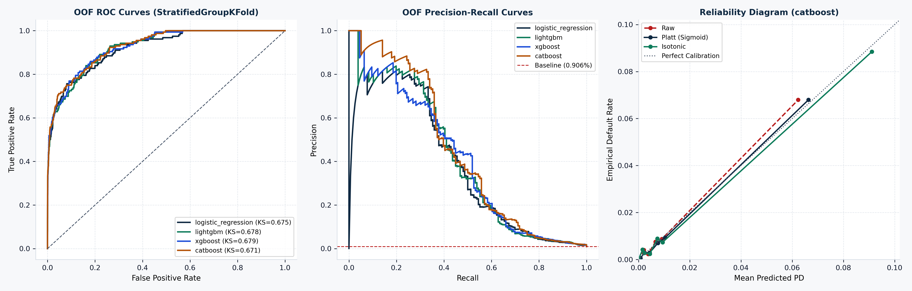
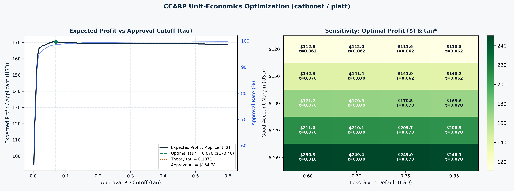
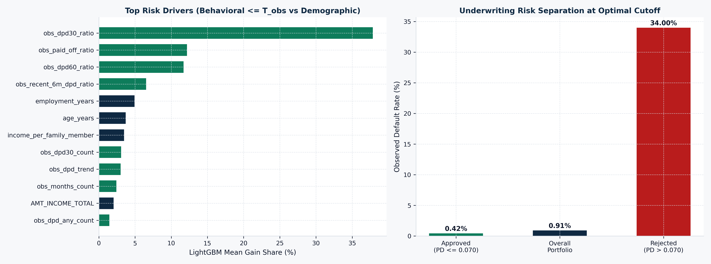

<div align="center">

# CCARP — Credit Card Approval Risk & Profit Scoring

### Temporal-Leakage-Free Default Scoring, Demographic-Clone GroupKFold, Fold-Internal Probability Calibration & Unit-Economics Expected Profit Optimization

<br/>


-0E7C5B?style=flat-square)


<br/>

**"From Data to Systems"**
End-to-end retail credit underwriting and portfolio profitability system on `rikdifos/credit-card-approval-prediction`, enforcing strict causal observation cutoff (`MONTHS_BALANCE <= -12`), demographic-clone `StratifiedGroupKFold` isolation, zero-leakage fold-internal probability calibration, and expected-profit decision optimization (`tau*`).

</div>

<br/>

<table align="center">
<tr>
<td align="center"><h2>36,457 / 17,220</h2><sub>joined IDs / T_obs=-12 cohort</sub></td>
<td align="center"><h2>0.906%</h2><sub>12M forward 60+ DPD default rate</sub></td>
<td align="center"><h2>0.9293</h2><sub>CatBoost Platt OOF ROC-AUC (-0.0695 vs leaky)</sub></td>
<td align="center"><h2>0.00632 / 0.671</h2><sub>Brier Score / KS Statistic</sub></td>
<td align="center"><h2>$170.46</h2><sub>optimal profit / applicant at tau* = 0.070 (+$5.68 lift)</sub></td>
</tr>
</table>

---

## Table of Contents

1. [Problem Statement & Methodological Pitfalls](#1-problem-statement--methodological-pitfalls)
2. [System Architecture & Causal Sequence (Mermaid)](#2-system-architecture--causal-sequence)
3. [Data Provenance & Variable Dictionary](#3-data-provenance--variable-dictionary)
4. [Leakage Ablation, Model Benchmarks & Calibration Results](#4-leakage-ablation-model-benchmarks--calibration-results)
5. [Unit-Economics Expected Profit Optimization & Sensitivity](#5-unit-economics-expected-profit-optimization--sensitivity)
6. [Visual Evidence (300 DPI)](#6-visual-evidence-300-dpi)
7. [Interactive Dashboard, Notebook & Quickstart](#7-interactive-dashboard-notebook--quickstart)
8. [Repository Structure & ELMAS.md Compliance](#8-repository-structure--elmasmd-compliance)
9. [Scientific Conclusion](#9-scientific-conclusion)

---

## 1. Problem Statement & Methodological Pitfalls

Standard public notebooks on the Kaggle Credit Card Approval dataset frequently report inflated `0.99+` ROC-AUC scores because of four structural failure modes. **CCARP** eliminates each failure mode deterministically:

| Failure Mode | Naive Practice | CCARP Engineering Guard | Empirical Impact |
|---|---|---|---|
| **Temporal Look-Ahead Leakage** | Aggregating `credit_record.csv` across all `MONTHS_BALANCE` in `[-60, 0]` to predict a label derived from the same window | Strict causal cutoff `T_obs = -12`: features computed strictly from `MONTHS_BALANCE <= -12` (`min >= 3`), 60+ DPD target strictly from `MONTHS_BALANCE > -12` (`min >= 6`) | Eliminates `+0.0722` ROC-AUC and `+0.4895` PR-AUC target leakage |
| **Duplicate Demographic Clones** | Splitting randomly with `StratifiedKFold`, placing identical demographic profiles (separate `ID`s) in both train and validation folds | Deterministic 13-column SHA-256 `demo_group_key` (`82.35%` of cohort belongs to multi-ID clusters; `38.31%` default rate in positive clusters) enforced via `StratifiedGroupKFold(5)` | Eliminates 5x artificial PR-AUC inflation (`0.0566` down to `0.0113` on Demo-Only) |
| **Sentinel & Missingness Distortion** | Treating `DAYS_EMPLOYED = 365243` (~1,000 years) as a raw integer or imputing medians globally before CV | Maps `365243` to `NaN` + binary `is_unemployed_or_retired` flag; splits `OCCUPATION_TYPE` nulls into `Pensioner_or_Retired` vs `Missing_Occupation`; imputes inside fold `Pipeline` | Zero fold-statistics leakage and exact pensioner/unemployed semantics |
| **Probability-to-Profit Disconnect** | Approving at default `tau = 0.50` or uncalibrated tree scores | Fold-internal 3-fold `StratifiedGroupKFold` OOF Platt & Isotonic calibration paired with unit-economics sweep (`M_good = $180`, `LGD = 0.75`, `EAD = $2,000`) | Optimal `tau* = 0.070` cuts approved bad rate by `53.8%` (`0.906%` to `0.418%`) and yields `+$97,800` portfolio lift |

---

## 2. System Architecture & Causal Sequence

### End-to-End Pipeline Architecture

```mermaid
flowchart LR
    RAW["application_record.csv (438,557) + credit_record.csv (1,048,575)"] --> JOIN["src/ingestion/relational_join.py (36,457 Matched IDs)"]
    JOIN --> TEMP["src/features/temporal_splitter.py (Cutoff T_obs = -12)"]
    JOIN --> DEMO["src/features/demographic_cleaner.py + profile_grouping.py"]
    TEMP --> BEH["src/features/behavioral_aggregator.py (Obs <= -12 Only)"]
    DEMO --> MAT["Leak-Free Feature Matrix (17,220 x 26 + SHA-256 Group Keys)"]
    BEH --> MAT
    MAT --> CV["src/modeling/cv_splitter.py (StratifiedGroupKFold 5-Fold)"]
    CV --> CAL["src/modeling/probability_calibrator.py (Inner 3-Fold Platt + Isotonic)"]
    CAL --> EVAL["src/evaluation/profit_optimizer.py (tau* = 0.070, $170.46 / App)"]
    EVAL --> OUT["images/ccarp_*.png + artifacts/dashboard.html + artifacts/results.json"]
```



### Strict Temporal Window & Zero-Leakage Calibration Sequence



---

## 3. Data Provenance & Variable Dictionary

- **Source Dataset**: [`rikdifos/credit-card-approval-prediction`](https://www.kaggle.com/datasets/rikdifos/credit-card-approval-prediction) downloaded via Kaggle CLI (`KAGGLE_CONFIG_DIR="PCCF"`).
- **Relational Audit**:
  - `application_record.csv`: `438,557` raw rows -> `438,510` unique `ID`s (`94` rows across `47` duplicate `ID`s removed deterministically).
  - `credit_record.csv`: `1,048,575` monthly ledger rows across `45,985` unique `ID`s (`0` duplicate `(ID, MONTHS_BALANCE)` pairs).
  - **Inner Join**: **`36,457`** matched clients (`777,715` ledger rows); `402,053` application-only `ID`s and `9,528` credit-only `ID`s excluded.
  - **Cohort Retention at `T_obs = -12` (`min_obs_months = 3`, `min_perf_months = 6`)**: **`17,220`** accounts (`47.23%` of joined), **`156` defaults (`0.906%`)**, `6,943` unique 13-column SHA-256 demographic clusters (`82.35%` of clients in multi-ID clusters).

### Variable Dictionary

| Variable | Origin | Type | Temporal / Cleaning Guard | Business & Risk Meaning |
|---|---|---|---|---|
| `ID` | Raw Join Key | `int64` | Deduplicated (`keep="first"`), inner-joined | Unique credit card account identifier |
| `MONTHS_BALANCE` | `credit_record` | `int64` | Partitioned at `<= -12` (obs) vs `> -12` (perf) | Monthly ledger offset backward from extraction (`0` = current) |
| `STATUS` | `credit_record` | `str` | Target `{'2','3','4','5'}` only in `> -12` | `0`: 1-29 DPD, `1`: 30-59 DPD, `2-5`: 60+ DPD default, `C`: paid off, `X`: no loan |
| `age_years` | `DAYS_BIRTH` | `float64` | `-DAYS_BIRTH / 365.25` | Applicant age in years at application |
| `employment_years` | `DAYS_EMPLOYED` | `float64` | Sentinel `365243 -> NaN`; median imputed inside CV | Tenure in current employment (years) |
| `is_unemployed_or_retired` | `DAYS_EMPLOYED` | `int8` | `1` iff `DAYS_EMPLOYED == 365243` | Explicit flag capturing the 17.18% pensioner/unemployed sentinel |
| `is_occupation_missing` | `OCCUPATION_TYPE` | `int8` | `1` iff `OCCUPATION_TYPE` is null | Missing-not-at-random indicator |
| `occupation_clean` | `OCCUPATION_TYPE` | `str` | Splits nulls into `Pensioner_or_Retired` vs `Missing_Occupation` | Disambiguated occupational category |
| `income_per_family_member` | Derived | `float64` | `AMT_INCOME_TOTAL / max(CNT_FAM_MEMBERS, 1)` | Household income capacity adjusted for family size |
| `children_ratio` | Derived | `float64` | `CNT_CHILDREN / max(CNT_FAM_MEMBERS, 1)` | Dependent burden ratio |
| `AMT_INCOME_TOTAL`, `CNT_CHILDREN`, `CNT_FAM_MEMBERS` | `application_record` | Numeric | `FLAG_MOBIL` dropped (constant `1`) | Gross income and household structure |
| `CODE_GENDER`, `FLAG_OWN_CAR`, `FLAG_OWN_REALTY`, `NAME_*` | `application_record` | Categorical | One-hot encoded inside CV `Pipeline` | Socio-demographic and housing profile |
| `obs_months_count`, `obs_span_months`, `obs_recency_months` | `obs_df (<= -12)` | `float64` | Strict `MONTHS_BALANCE <= -12` | Observation history depth, span, and recency to cutoff |
| `obs_dpd_any_*`, `obs_dpd30_*`, `obs_dpd60_*` | `obs_df (<= -12)` | `float64` | Strict `MONTHS_BALANCE <= -12` | Pre-cutoff delinquency counts and ratios across severity tiers |
| `obs_paid_off_ratio`, `obs_no_loan_ratio`, `obs_max_severity` | `obs_df (<= -12)` | `float64` | Strict `MONTHS_BALANCE <= -12` | Repayment utilization and peak historical severity (`0..6`) |
| `obs_recent_6m_dpd_ratio`, `obs_dpd_trend` | `obs_df (<= -12)` | `float64` | Window `[-17, -12]` vs full obs ratio | Short-term delinquency momentum heading into cutoff |

---

## 4. Leakage Ablation, Model Benchmarks & Calibration Results

### Temporal & Demographic-Group Leakage Ablation (LightGBM, `N = 17,220`, `156` Defaults)

| Ablation Regime | Feature Scope | CV Splitter | ROC-AUC | PR-AUC | Brier Score | KS Stat |
|---|---|---|---:|---:|---:|---:|
| **Demo Only + StratifiedKFold** | Demographics Only | `StratifiedKFold(5)` | `0.6575` | `0.0566` | `0.00881` | `0.2461` |
| **Demo Only + StratifiedGroupKFold** | Demographics Only | `StratifiedGroupKFold(5)` | `0.5717` | `0.0113` | `0.00909` | `0.1467` |
| **Leak-Free + StratifiedKFold** | `Demo + Obs <= -12` | `StratifiedKFold(5)` | `0.9284` | `0.4709` | `0.00610` | `0.6974` |
| **Leak-Free + StratifiedGroupKFold (Primary)** | `Demo + Obs <= -12` | `StratifiedGroupKFold(5)` | `0.9267` | `0.4081` | `0.00648` | `0.6784` |
| **Leak-Free + GroupKFold** | `Demo + Obs <= -12` | `GroupKFold(5)` | `0.9188` | `0.4251` | `0.00646` | `0.6483` |
| **Naive Full-History + StratifiedGroupKFold** | `Demo + All [-60, 0]` | `StratifiedGroupKFold(5)` | `0.9988` | `0.8976` | `0.00248` | `0.9851` |

### Multi-Model Out-of-Fold Calibration Comparison (`StratifiedGroupKFold(5)`)

| Model | Calibration | ROC-AUC | PR-AUC | Brier Score | Log-Loss | ECE (10-bin) | KS Stat |
|---|---|---:|---:|---:|---:|---:|---:|
| `logistic_regression` | `raw` / `platt` / `isotonic` | `0.9203` / `0.9198` / `0.9130` | `0.3783` / `0.3796` / `0.3716` | `0.00660` / `0.00664` / `0.00662` | `0.03171` / `0.03170` / `0.03302` | `0.00124` / `0.00139` / `0.00060` | `0.6797` / `0.6752` / `0.6661` |
| `lightgbm` | `raw` / `platt` / `isotonic` | `0.9267` / `0.9262` / `0.9195` | `0.4081` / `0.4054` / `0.4011` | `0.00648` / `0.00651` / `0.00651` | `0.03095` / `0.03090` / `0.03240` | `0.00159` / `0.00050` / `0.00088` | `0.6784` / `0.6780` / `0.6642` |
| `xgboost` | `raw` / `platt` / `isotonic` | `0.9275` / `0.9271` / `0.9224` | `0.4103` / `0.4067` / `0.3763` | `0.00659` / `0.00660` / `0.00672` | `0.03089` / `0.03091` / `0.03484` | `0.00064` / `0.00072` / `0.00107` | `0.6816` / `0.6788` / `0.6809` |
| **`catboost` (Best)** | `raw` / **`platt`** / `isotonic` | `0.9299` / **`0.9293`** / `0.9282` | `0.4407` / **`0.4400`** / `0.4271` | `0.00631` / **`0.00632`** / `0.00633` | `0.02989` / **`0.02992`** / `0.03041` | `0.00138` / **`0.00109`** / `0.00099` | `0.6763` / **`0.6714`** / `0.6682` |

### Hyperparameter Summary

| Model | Family | Key Hyperparameters | Calibration Method | Role |
|---|---|---|---|---|
| `logistic_regression` | Linear / GLM | `C=0.5`, `max_iter=1000`, `StandardScaler`, Median Imputer | 3-fold inner `StratifiedGroupKFold` Platt & Isotonic | Interpretable scorecard baseline |
| `lightgbm` | Histogram GBDT | `n_estimators=300`, `lr=0.04`, `num_leaves=15`, `max_depth=4`, `min_child_samples=50`, `reg_lambda=5.0` | 3-fold inner `StratifiedGroupKFold` Platt & Isotonic | Non-linear scorer & feature gain audit |
| `xgboost` | Hist GBDT | `n_estimators=300`, `lr=0.04`, `max_depth=4`, `min_child_weight=20.0`, `reg_lambda=5.0`, `hist` | 3-fold inner `StratifiedGroupKFold` Platt & Isotonic | Cross-library GBDT benchmark |
| `catboost` | Symmetric Trees | `iterations=400`, `lr=0.04`, `depth=4`, `l2_leaf_reg=8.0`, `allow_writing_files=False` | 3-fold inner `StratifiedGroupKFold` Platt & Isotonic | Primary calibrated underwriting scorer |

---

## 5. Unit-Economics Expected Profit Optimization & Sensitivity

Under retail revolving credit economics (`M_good = $180`, `LGD = 0.75`, `EAD = $2,000`, `loss_default = $1,500`), the analytical break-even default probability is `tau_theory = 180 / (180 + 1500) = 0.1071` (`10.71%`). Sweeping `tau in [0.002, 1.000]` on out-of-fold Platt-calibrated `catboost` probabilities maximizes expected profit at **`tau* = 0.070`**:

| Underwriting Policy | PD Cutoff (`tau`) | Approval Rate | Approved Accounts | Approved Bad Rate | Expected Profit / Applicant | Total Portfolio Profit | Lift vs Approve-All |
|---|---:|---:|---:|---:|---:|---:|---:|
| **Optimal Empirical (`tau*`)** | **`0.0700`** | **`98.55%`** | **`16,970`** | **`0.418%`** | **`$170.46`** | **`$2,935,320`** | **`+$5.68 / app (+$97,800)`** |
| Analytical Break-Even (`tau_theory`) | `0.1071` | `98.98%` | `17,045` | `0.505%` | `$169.78` | `$2,923,620` | `+$5.00 / app (+$86,100)` |
| Naive Cutoff (`tau = 0.50`) | `0.5000` | `99.63%` | `17,156` | `0.606%` | `$169.18` | `$2,913,360` | `+$4.40 / app (+$75,840)` |
| Approve All (`tau = 1.00`) | `1.0000` | `100.00%` | `17,220` | `0.906%` | `$164.78` | `$2,837,520` | `$0.00` |

Across the `5 x 4` `(margin_good, LGD)` sensitivity grid (`$120..$260` x `0.60..0.85`), optimal cutoff policies deliver persistent positive profit lift ranging from **`+$3.57` to `+$7.31` per applicant** over `Approve-All`.

---

## 6. Visual Evidence (300 DPI)

| Figure | Analysis |
|---|---|
|  | **Temporal Cutoff Grid & Leakage Ablation.** Left: `T_obs` tradeoff (`N=17,220` at `T=-12`). Right: 6-regime proof of temporal (`0.9988` vs `0.9267`) and demographic-clone leakage (`PR-AUC 0.0566` vs `0.0113`). |
|  | **OOF Discrimination & Calibration.** ROC (`0.9293` CatBoost), Precision-Recall (`0.4400` vs `0.0091` baseline), and decile Reliability Diagram confirming close diagonal alignment after Platt calibration. |
|  | **Unit-Economics Profit Optimization & Sensitivity.** Peak profit `$170.46/applicant` at `tau* = 0.070`, paired with the 20-cell `(margin_good x LGD)` robustness heatmap. |
|  | **Pre-Cutoff Risk Drivers & Portfolio Separation.** `obs_dpd30_ratio`, `obs_paid_off_ratio`, and `obs_dpd60_ratio` dominate LightGBM gain; rejecting the `1.45%` tail above `tau*` isolates a `34.00%` default segment vs `0.42%` among approved accounts. |

---

## 7. Interactive Dashboard, Notebook & Quickstart

- **Interactive Plotly Underwriting Desk**: [`artifacts/dashboard.html`](./artifacts/dashboard.html) (institutional slate/navy/emerald light theme, `tabular-nums` alignment, interactive ablation, calibration, profit curve, and risk drivers).
- **Reproducible Results JSON**: [`artifacts/results.json`](./artifacts/results.json).
- **Executed Walkthrough Notebook**: [`notebooks/ccarp_credit_risk_profit_study.ipynb`](./notebooks/ccarp_credit_risk_profit_study.ipynb).

### Quickstart (PowerShell / Python 3.10)

```powershell
# 1. Run end-to-end ingestion (downloads Kaggle dataset if absent), modeling, figures & dashboard
.\run.ps1

# 2. Execute full automated verification & ELMAS.md compliance suite
& "C:\Users\elmas\AppData\Local\Programs\Python\Python310\python.exe" -m pytest -v

# 3. Re-execute the Jupyter notebook in place
& "C:\Users\elmas\AppData\Local\Programs\Python\Python310\python.exe" -m jupyter nbconvert --to notebook --execute --inplace notebooks/ccarp_credit_risk_profit_study.ipynb
```

---

## 8. Repository Structure & `ELMAS.md` Compliance

```text
CCARP/
├── .gitignore
├── ELMAS.md
├── README.md
├── pytest.ini
├── requirements.txt
├── run.ps1
├── main.py
├── data/
│   ├── raw/.gitkeep
│   └── processed/.gitkeep
├── artifacts/
│   ├── dashboard.html
│   └── results.json
├── images/
│   ├── ccarp_temporal_window_leakage.png
│   ├── ccarp_roc_pr_calibration.png
│   ├── ccarp_expected_profit_curve.png
│   └── ccarp_feature_risk_drivers.png
├── notebooks/
│   └── ccarp_credit_risk_profit_study.ipynb
├── src/
│   ├── core/               # Frozen @dataclass configs & immutable contracts
│   ├── ingestion/          # Kaggle CLI acquisition & relational ID join audit
│   ├── features/           # Temporal windowing, sentinel cleaning, demographic SHA-256 keys
│   ├── modeling/           # Group CV splitters, 4 credit models, fold-internal OOF calibration
│   ├── evaluation/         # Risk metrics, ablation audit, profit optimization & sensitivity
│   └── visualization/      # 300 DPI Matplotlib figures & institutional Plotly dashboard
└── tests/
    ├── test_ingestion_join.py
    ├── test_features_leakage_and_purity.py
    ├── test_modeling_calibration.py
    ├── test_evaluation_profit.py
    ├── test_visualization_pipeline.py
    └── test_elmas_compliance.py
```

All source modules strictly enforce [`ELMAS.md`](./ELMAS.md) (verified by `tests/test_elmas_compliance.py`): `<= 350` lines/file, `<= 3` parameters/function via frozen `@dataclass` contracts, `<= 3` indentation levels, pure transformations, zero `utils/`/`helpers/`/`misc/`/`common/` folders, and strictly unidirectional imports (`visualization -> evaluation -> modeling -> features -> ingestion -> core`).

---

## 9. Scientific Conclusion

> [!IMPORTANT]
> **Causal Temporal Isolation + Demographic-Cluster Grouping + Calibrated Profit Thresholding:** Naive full-history aggregation inflates OOF ROC-AUC from **`0.9267`** to **`0.9988`** (`PR-AUC` `0.4081` to `0.8976`), while ignoring the **`82.35%`** duplicate demographic-profile cluster structure via standard `StratifiedKFold` inflates Demo-Only `PR-AUC` nearly **5x** (`0.0566` vs `0.0113`). Under strict pre-cutoff observation (`MONTHS_BALANCE <= -12`) and `StratifiedGroupKFold(5)`, fold-internal Platt-calibrated **CatBoost** achieves **`0.9293` ROC-AUC**, **`0.4400` PR-AUC**, **`0.00632` Brier Score**, and **`0.6714` KS**. Pairing these calibrated PDs with unit-economics optimization (`M_good = $180`, `LGD = 0.75`, `EAD = $2,000`) shifts the approval cutoff from `0.50` down to **`tau* = 0.070`**, reducing approved defaults by **`53.8%`** (`0.906%` to `0.418%`) and generating **`$170.46` expected profit per applicant** (**`+$97,800`** portfolio lift over `Approve-All`).
